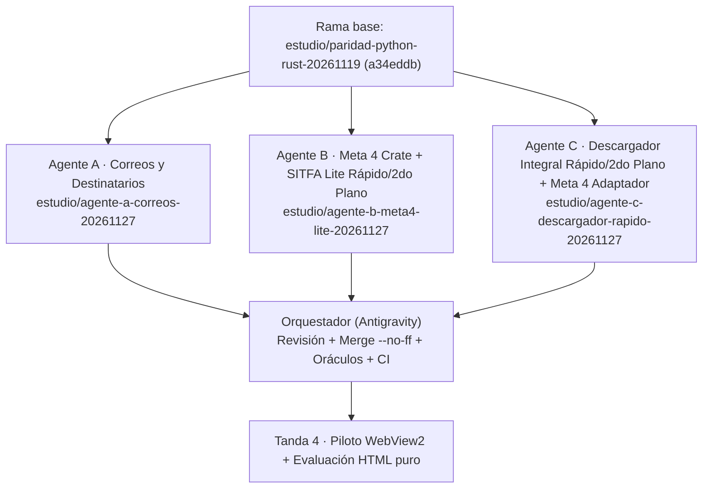

# Plan Técnico y Guía de Orquestación Multi-Agente — `MatiGaete2023/waffle`

**Fecha:** 27 de noviembre de 2026  
**Rama base:** `estudio/paridad-python-rust-20261119` (commit base `a34eddb`)  
**Modelo de ejecución:** 3 Agentes en paralelo (**A**, **B**, **C**) + **Orquestador** (modo rama o ZIP + `.patch`, conforme a `AGENTS.md` y `docs/migracion_python_rust/CONTINUACION.md`).

---

## 1. Decisiones Aprobadas por el Usuario (Marco Vinculante)

| ID | Decisión aprobada | Regla resultante |
|---|---|---|
| **D1-A** | Meta 4 acepta comprobante JSON sin PDF | `verificacion NNN.json` guarda `comprobante_sin_registros` con `sha256_html` y `evidencia_omitida: true`. Meta 4 lo reconoce como fuente válida `tipo: "JSON"` → `JSON · 0 registros` (`SIN REGISTROS`), sin alerta ni error fatal. |
| **D2-A** | Destinatarios inteligentes en Correos | Portar `learned_contacts` (aprendizaje automático al guardar) + tribunales dinámicos en Contactos/Importación + sugerencias en 1 clic si no hay coincidencia exacta. Nunca adivinar destinatario en silencio. |
| **D3-A** | Aceleración multipágina en ambos | Implementar `search_and_download`, pipelining local, pausa adaptativa y eliminación de trabajo redundante tanto en **Flow Rust (Integral)** como en **SITFA Lite**. |
| **D4-A** | Dos modos + validación HTML anónima | Separar **«Modo Registro / Auditoría»** (actual) y **«Modo Rápido / Solo Datos»** (XLS en memoria + pipelining + JSON sin PDF). En paralelo, emitir diagnóstico anónimo de columnas HTML vs XLS (`E-X3`) para evaluar modo HTML puro en Tanda 4. |
| **D5-A** | 2do plano en 2 pasos | **Tanda 3:** 2do plano estable con extensión (JSON sin PDF por defecto + `autoDiscardable: false` + Keep-Alive/anti-suspensión). **Tanda 4:** Piloto **WebView2 embebido** sin extensión de Chrome (`trait Conexion`). |
| **D6-C** | Ejecución en paralelo | Fase 1 (Meta 4 JSON + Correos) y Fase 2 (Velocidad multipágina + 2do plano) corren **simultáneamente** en 3 ramas aisladas sin solapamiento de archivos. |

### Reglas invariantes obligatorias para todas las IAs (`AGENTS.md`)
1. **Solo lectura en RUS/SITFA** (`tools/verificar_solo_lectura.py` debe pasar en verde).
2. **Outlook solo borradores** (`mail.Save()`, nunca `.Send()`, CC obligatorio `ucc_concepcion@pjud.cl`).
3. **Sin credenciales, cookies ni tokens** en código, logs o disco.
4. **Sin datos reales** en código, pruebas ni informes (en pruebas usar siempre `@example.test`).
5. **Solo el Orquestador** edita `ESTADO.md`, `PLAN.md`, `REGISTRO_IMPLEMENTACION.md`, `AGENTS.md`, `CONTINUACION.md` y `.github/workflows/**`.

---

## 2. Contratos Congelados (Antes de Iniciar Trabajo en Paralelo)

Para garantizar integración limpia sin conflictos entre **Agente B** y **Agente C**, los siguientes contratos quedan congelados desde el inicio:

### Contrato 1 · Comprobante JSON sin registros (`V-JSON-01`)
Escrito por `app/src/descargador/lote.rs` (Agente C) y `descargador_lite/app/lotes.py` (Agente B) cuando `evidencia == false` y la respuesta de SITFA es `SIN_RESULTADOS`:

```json
{
  "estado": "SIN_RESULTADOS",
  "evidencia_omitida": true,
  "comprobante_sin_registros": {
    "tipo": "JSON_SIN_REGISTROS",
    "fecha_hora": "2026-11-27T11:40:00.000000",
    "sha256_html": "<64 caracteres hexadecimales del HTML validado de SITFA>",
    "contexto_consulta": [
      ["Tribunal", "..."],
      ["Consulta", "..."]
    ]
  }
}
```
- **Compatibilidad hacia atrás:** `meta4.rs` (Agente C) también acepta lotes previos que solo tengan `"estado": "SIN_RESULTADOS"` y `"evidencia_omitida": true` (sin `comprobante_sin_registros`).
- **Tipo de fuente en `flow-meta4` (Agente B):** `Fuente.tipo` admite `"EXCEL"`, `"PDF"` y `"JSON"`. En `rust/crates/flow-meta4/src/salida.rs`, `MATRIZ_COBERTURA` muestra `"JSON · 0 registros"` cuando existe fuente `"JSON"` (sin marcar `FALTANTE`).

### Contrato 2 · Comando compuesto `search_and_download` (`V-PAG-01`)
Implementado en `extension_integral` v`2.11.0` (`flow_rust_rapido: 2`, Agente C) y `descargador_lite/extension` v`1.2.0` (`protocolos.search_and_download: 1`, Agente B):
- **Entrada (`payload`):**
  ```json
  {
    "pairs": [["COD_Tribunal_sel", "119"], ...],
    "timeout": 60000,
    "index_dom": false,
    "template": "amblistcump"
  }
  ```
- **Salida exitosa:**
  ```json
  {
    "html": { "status": 200, "type": "text/html; ...", "body": "<base64>" },
    "excel": {
      "status": 200,
      "type": "application/vnd.ms-excel",
      "url": "https://familia.pjud.cl/sitfa/reportes/...xls",
      "body": "<base64>"
    }
  }
  ```
  *(Si el HTML no tiene enlace `ShowExcel` —ej. consulta vacía— `"excel": null` y se devuelve solo `"html"`.)*
- **Regla de seguridad:** La extensión solo descarga la URL si cumple `^https://familia\.pjud\.cl/sitfa/reportes/[A-Za-z0-9_-]+\.xls$` (y coincide con `template` si viene informado). Rust/Python ejecutan **exactamente las mismas validaciones** HTML↔XLS al recibir ambos cuerpos.
- **Fallback obligatorio:** Si la extensión conectada no anuncia `search_and_download`, el motor usa automáticamente el flujo clásico `search` → `download`.

### Contrato 3 · Diagnóstico anónimo de columnas HTML vs XLS (`E-X3`)
Generado por Agente C (opcional/automático en lote de listados) en `<carpeta_lote>/diagnostico_columnas_html_xls.json`:
```json
{
  "version": 1,
  "pantalla": "seguimiento",
  "consultas": [
    {
      "pestana": "Cumplimiento",
      "modalidad": "Ambulatorio",
      "columnas_html": ["RIT", "NOMBRE", "..."],
      "columnas_xls": ["RIT", "RUT", "NOMBRE", "..."],
      "solo_en_xls": ["RUT"],
      "solo_en_html": []
    }
  ]
}
```
- **Prohibición estricta:** Solo nombres de encabezados y conteos. **Nunca** valores de filas, RIT, RUT ni nombres de personas.

---

## 3. Mapa de Territorios y Cero Colisiones (Tanda 3 en Paralelo)



| Agente | Rama | Archivos de propiedad exclusiva (NO tocar fuera de esta lista) | Entregable |
|---|---|---|---|
| **Agente A** | `estudio/agente-a-correos-20261127` | `app/src/config.rs`, `app/src/personalizar.rs`, `app/src/productos.rs`, `app/src/outlook.rs`, `app/src/ui.rs` (solo vistas Correos/Contactos/Ajustes), `docs/migracion_python_rust/informes/AGENTE_A_20261127_correos.md` | Encargo `E-P3-A1` |
| **Agente B** | `estudio/agente-b-meta4-lite-20261127` | `rust/crates/flow-meta4/**`, `descargador_lite/app/**`, `descargador_lite/extension/**`, `descargador_lite/tests/**`, `docs/migracion_python_rust/informes/AGENTE_B_20261127_meta4_lite.md` | Encargo `E-P3-B1` |
| **Agente C** | `estudio/agente-c-descargador-rapido-20261127` | `app/src/descargador/**` (incl. `extension_integral/**`), `app/src/descargador_ui.rs`, `app/src/meta4_ui.rs`, `docs/migracion_python_rust/informes/AGENTE_C_20261127_descargador.md` | Encargo `E-P3-C1` |
| **Orquestador** | `estudio/paridad-python-rust-20261119` | Integración, `app/qa/generar_meta4.py` + `app/tests/datos/meta4.json` (si cambia oráculo), `ESTADO.md`, `PLAN.md`, `REGISTRO_IMPLEMENTACION.md`, `CONTINUACION.md` | Integración y CI |

---

## 4. Especificación Técnica Detallada por Agente (Tanda 3)

### 4.1 Agente A — Encargo `E-P3-A1`: Destinatarios Inteligentes en Correos (`D2-A`)

**Qué cambiar y dónde:**
1. **Aprendizaje automático de contactos (`app/src/productos.rs` + `app/src/ui.rs`):**
   - Implementar `pub fn contactos_aprendidos(cfg: &Config, borradores: &[Borrador]) -> BTreeMap<String, String>` (paridad con `learned_contacts` de `src/nurus/personal/outputs.py:196-214`).
   - Al completar exitosamente el guardado de borradores (Outlook o `.eml`) en `ui.rs`, incorporar automáticamente las direcciones válidas escritas a mano para programas/tribunales que no tenían contacto previo (sin pisar existentes ni guardar si hay conflicto para el mismo nombre), persistir `config::save(&self.cfg)` y mostrar aviso *«Contacto guardado para el próximo lote: …»*.
2. **Tribunales dinámicos (`app/src/config.rs` + `app/src/personalizar.rs` + `app/src/productos.rs`):**
   - En `personalizar::guardar_contacto` (`personalizar.rs:46-50`): eliminar el rechazo `"Tribunal no reconocido."` para claves `Tribunal: <NOMBRE>`. Si la clave normalizada en mayúsculas no existe en `r.tribunales`, insertarla automáticamente con `Tribunal { nombre, para }`.
   - En `personalizar::importar_contactos_archivo` (`personalizar.rs:193`): procesar filas `Tribunal: <X>` **también en `.xlsx` y `.xls`** (no solo en `.json`/`.csv`/`.html`) y crear el tribunal en `r.tribunales` si no existía.
   - En `productos.rs` (`preparar_borradores`, `borrador_plantilla`): resolver destinatario del tribunal buscando por clave exacta y por `clave(nombre)` normalizada.
3. **Resolución en cascada y sugerencias en 1 clic (`app/src/config.rs` + `app/src/ui.rs`):**
   - En `Config::contacto_programa(&self, programa: &str)`:
     1. Coincidencia exacta por `clave()` en `contactos` o `aliases`.
     2. Coincidencia exacta tras `sin_parentesis(programa)` (solo si produce un único contacto inequívoco).
   - Agregar `Config::sugerir_contactos(&self, programa: &str, max: usize) -> Vec<(String, String)>` (coincidencia por tokens compartidos / prefijo de sigla).
   - En la vista **Correos** (`ui.rs` alrededor de línea 2614): cuando `b.para` esté vacío, mostrar hasta 3 botones compactos de sugerencia (*«Usar: PRM … (guardar alias)»*). Al hacer clic, completa `b.para`, guarda el alias en `self.cfg.aliases` y persiste `config.json`.
   - En la vista **Contactos / Ajustes**: botón explícito **«Reimportar contactos desde Flow Python»** que reinicia las banderas de migración y ejecuta `migrar_contactos_python` sin sobrescribir contactos locales existentes.
4. **Resolución en Outlook COM (`app/src/outlook.rs`):**
   - En `SCRIPT` (después de asignar `$m.To` y `$m.CC`, antes de `Save()`): agregar `try { [void]$m.Recipients.ResolveAll() } catch {}` (nunca aborta el guardado si Outlook no tiene conexión Exchange, pero resuelve nombres/direcciones en la libreta cuando sí está conectado). Mantener `Save()` y cero `.Send(`.

**Resultado esperado y pruebas obligatorias:**
- Ningún destinatario válido escrito manualmente debe volver a pedirse en el siguiente lote.
- Tribunales nuevos (Plan Waffle) aceptan contactos tanto manuales como importados por Excel/JSON.
- Pruebas permanentes en `config.rs`, `personalizar.rs`, `productos.rs` y `outlook.rs` (usando `@example.test`):
  - `aprendizaje_guarda_nuevo_y_no_pisa_existente_ni_ambiguo`
  - `guardar_e_importar_tribunal_adicional_desde_excel_y_json`
  - `contacto_programa_resuelve_sin_parentesis_y_sugiere_candidatos`
  - `outlook_script_resuelve_destinatarios_y_nunca_envia`

---

### 4.2 Agente B — Encargo `E-P3-B1`: Crate `flow-meta4` (JSON sin PDF) + SITFA Lite Rápido y 2do Plano (`D1-A`, `D3-A`, `D4-A`, `D5-A`)

**Qué cambiar y dónde:**
1. **Crate `rust/crates/flow-meta4/` (`src/lib.rs`, `src/salida.rs`, `tests/`):**
   - Actualizar `Fuente.tipo` y su documentación en `src/lib.rs:180` para aceptar `"EXCEL"`, `"PDF"` y `"JSON"`.
   - En `src/salida.rs:401-404` (`MATRIZ_COBERTURA`):
     ```rust
     } else if fuentes.iter().any(|f| f.tipo == "PDF") {
         "PDF · 0 registros".into()
     } else if fuentes.iter().any(|f| f.tipo == "JSON") {
         "JSON · 0 registros".into()
     } else {
         "FALTANTE".into()
     }
     ```
   - Verificar que `INVENTARIO_ARCHIVOS` y los conteos de cobertura contabilicen `"JSON"` exactamente igual que `"PDF"` (no `FALTANTE`).
   - Agregar prueba permanente en `rust/crates/flow-meta4/tests/` que acredite que una fuente `tipo: "JSON"` marca `"JSON · 0 registros"` en `MATRIZ_COBERTURA` y `"SIN REGISTROS"` en `INVENTARIO_ARCHIVOS`.
2. **SITFA Lite — Comprobante JSON sin PDF (`descargador_lite/app/lotes.py`):**
   - Cuando `self.evidencia == False` y `first is None`, calcular `sha256` del HTML validado de respuesta vacía y escribir `comprobante_sin_registros` según **Contrato 1 (`V-JSON-01`)** en `verificacion NNN.json`, conservando `evidencia_omitida: True`.
   - Cambiar el valor por defecto de `pdf_sin_registros` en `sitfa_lite.py:36` a `False` para favorecer ejecución en 2do plano (manteniendo el chip «PDF si no hay registros» visible y activable en 1 clic para Modo Registro).
3. **SITFA Lite — Aceleración multipágina (`descargador_lite/app/motor.py`, `lotes.py`, `puente.py`, `extension/pagina.js`, `extension/conexion.js`):**
   - **Eliminar doble parseo XLS (`motor.py:739`):** Tras `save_exclusive(path, content)`, comprobar únicamente `path.read_bytes() == content` (sin volver a llamar a `verified_download(saved, ...)`).
   - **Comando `search_and_download` (`extension/pagina.js` + `extension/conexion.js` + `motor.py`):** Implementar **Contrato 2 (`V-PAG-01`)** subiendo la extensión Lite a versión `1.2.0` (`protocolos.search_and_download: 1`), con fallback automático si no está presente.
   - **Pipelining local de página $n$ con `POST(n+1)` (`motor.py::run_sequence`):** Apenas llega el XLS de página $n$ en RAM, despachar la validación XLS + escritura en disco + `fsync` + manifiesto en un `ThreadPoolExecutor(max_workers=1)` mientras el hilo principal lanza inmediatamente `search_and_download` de la página $n+1$. Al terminar o ante cualquier excepción del worker, detener y propagar el error con manifiesto `"INCOMPLETA"`.
   - **Pausa adaptativa en paginación (`motor.py` / `sitfa_lite.py`):** Descontar la latencia ya transcurrida de la petición anterior; agregar selector **«Modo Rápido» vs «Modo Registro»** en UI (en Modo Rápido: sin PDF, pausa mínima adaptativa 0.2 s, `fsync` opcional al final del lote).
   - **2do plano estable (`descargador_lite/extension/conexion.js` + `background.js`):** Llamar a `chrome.tabs.update(tabId, {autoDiscardable: false})` al iniciar `lock` y restaurarlo en `unlock`/`disconnect`, evitando que Chrome suspenda la pestaña minimizada.

**Resultado esperado y pruebas obligatorias:**
- `cargo test --manifest-path rust/crates/flow-meta4/Cargo.toml` 100% en verde con nueva prueba JSON.
- `pytest descargador_lite/tests/` 100% en verde con nuevas pruebas:
  - `test_comprobante_json_sin_pdf_tiene_sha256_html`
  - `test_search_and_download_multipagina_y_fallback`
  - `test_pipelining_detecta_error_validacion_en_pagina_anterior`
  - `test_no_reparsea_xls_al_releer_disco`

---

### 4.3 Agente C — Encargo `E-P3-C1`: Descargador Integral Rápido, 2do Plano, Meta 4 JSON y Diagnóstico HTML (`D1-A`, `D3-A`, `D4-A`, `D5-A`)

**Qué cambiar y dónde:**
1. **Comprobante JSON sin PDF en `app/src/descargador/lote.rs`:**
   - Al recibir `Respuesta::SinRegistros` con `!opciones.evidencia`, generar `comprobante_sin_registros` según **Contrato 1 (`V-JSON-01`)** usando `huella(&html)` (el SHA-256 real del HTML validado de SITFA) y `contexto_integral` / `contexto`.
   - Cambiar `Preferencias::default().pdf_sin_registros` a `false` en `preferencias.rs:160` (2do plano por defecto; Modo Registro lo activa).
2. **Meta 4 aceptando comprobante JSON (`app/src/descargador/meta4.rs` + `app/src/meta4_ui.rs`):**
   - En `ConsultaMeta4`: sustituir `evidencia: Option<String>` por un enum:
     ```rust
     enum EvidenciaVacia {
         Pdf(String),
         Json(String), // nombre del archivo verificacion NNN.json
     }
     ```
   - Reconocer como `EvidenciaVacia::Json` toda consulta `estado == "SIN_RESULTADOS"` cuyo `verificacion NNN.json` tenga `comprobante_sin_registros["tipo"] == "JSON_SIN_REGISTROS"` o `evidencia_omitida == true`.
   - En `meta4.rs:565-583`: si es `EvidenciaVacia::Json`, incrementar `vacias += 1`, empujar `FuenteMeta4 { archivo: verificacion, tipo: "JSON", registros: 0, resultado: "SIN REGISTROS" / "NO CLASIFICADO", ... }` y **NO** agregar a `sin_evidencia`.
   - Incluir `EvidenciaVacia::Json` en `con_candidatos` (`meta4.rs:642`) para que un lote solo con consultas vacías acreditadas en JSON no falle.
   - *(Nota: como `rust/crates/flow-meta4/src/salida.rs` es territorio de Agente B, en pruebas unitarias de `meta4.rs` verificar `m.fuentes` con `tipo == "JSON"` y `m.avisos` sin alerta de PDF faltante; el Orquestador probará la integración completa con `flow-meta4::salida` al fusionar B + C.)*
3. **Aceleración multipágina + Modo Rápido vs Modo Registro (`lote.rs`, `preferencias.rs`, `puente.rs`, `extension_integral/`, `descargador_ui.rs`):**
   - **Extensión Integral `2.11.0` (`extension_integral/manifest.json`, `pagina.js`, `conexion.js`):**
     - Anunciar `flow_rust_version: "2.11.0"`, `flow_rust_rapido: 2`, `protocolos.search_and_download: 1`.
     - Implementar comando `search_and_download` según **Contrato 2 (`V-PAG-01`)**.
     - En `search` y `search_and_download`: ejecutar `asignarPagina` / `indexarPagina` **solo si `payload.index_dom !== false`** (ahorra parseo DOM en Chrome durante descargas de listados sin bitácoras).
     - En `conexion.js`: llamar a `chrome.tabs.update(tabId, {autoDiscardable: false})` en `lock` y restaurarlo en `unlock`/`disconnect`.
   - **Pipelining local en `lote.rs::paginas`:**
     - Apenas llega `XLS(n)` a memoria, delegar validación `verificador.verificar` + escritura + verificación disco + extracción `vinculos_ingreso` + manifiesto en un hilo worker (`std::thread::scope` / canal acotado) mientras el hilo principal dispara `search_and_download` de la página $n+1$ con pausa adaptativa (descontando la latencia de red ya consumida).
     - Mantener fallback automático a `search` + `download` si la extensión conectada es `2.10.0` o inferior.
   - **HTTP Keep-Alive en `app/src/descargador/puente.rs`:**
     - Soportar reutilización de conexión (`Connection: keep-alive`) en el loop de `aceptar()` con límite de peticiones por socket (ej. 64) y timeout de inactividad (10 s) para eliminar el overhead de reconexión TCP por página.
   - **UI (`app/src/descargador_ui.rs`):**
     - Selector claro en primer nivel: **«Modo Rápido (2do plano, JSON sin PDF)»** vs **«Modo Registro (respaldo completo con PDF)»**.
4. **Diagnóstico anónimo HTML vs XLS (`E-X3` en `lote.rs` / `sitfa.rs`):**
   - Al validar la primera página de cada consulta de Seguimiento, comparar los encabezados de la tabla HTML contra los encabezados del `.xls` y registrar únicamente los nombres de columnas en `diagnostico_columnas_html_xls.json` (**Contrato 3**, cero valores de filas).

**Resultado esperado y pruebas obligatorias:**
- `tools/probar_app.sh rapido descargador` + `meta4` en verde.
- Pruebas permanentes en `lote.rs`, `meta4.rs`, `puente.rs`:
  - `meta4_acepta_comprobante_json_sin_pdf_sin_alerta_ni_error`
  - `lote_multipagina_usa_search_and_download_y_pipelining`
  - `lote_multipagina_cae_a_search_y_download_con_extension_antigua`
  - `diagnostico_columnas_html_xls_no_filtra_datos_personales`
  - `puente_soporta_keep_alive_acotado`

---

## 5. Tanda 4 (Fase 3) — Piloto WebView2 Sin Extensión y Evaluación HTML Puro

Se ejecuta **después** de integrar y validar Tanda 3 en `estudio/paridad-python-rust-20261119`:

### 5.1 Encargo `E-P4-C1`: Piloto WebView2 embebido (Sin extensión de Chrome)
- **Territorio:** Nuevo módulo `app/src/descargador/webview.rs` + integración opcional en `app/src/descargador_ui.rs` (y equivalente `pywebview` en `descargador_lite/app/webview_transport.py`).
- **Diseño técnico limpio:**
  - Implementar el trait ya existente `lote::Conexion` sobre `CoreWebView2` (Windows 10/11 trae el runtime WebView2 preinstalado).
  - La ventana/panel WebView2 navega a `https://familia.pjud.cl/SITFAWEB/jsp/Login/LoginB4.jsp` para que el usuario autentique normalmente (ClaveÚnica / credenciales PJUD). **Cero acceso a cookies o contraseñas desde Rust.**
  - Una vez autenticado, el usuario puede ocultar/minimizar el panel y los comandos (`catalog`, `prepare`, `search_and_download`, `diary_open`, etc.) se ejecutan inyectando el mismo `pagina.js` de solo lectura mediante `ExecuteScript` y devolviendo resultados por `window.chrome.webview.postMessage` (sin puerto HTTP loopback ni código de conexión).
  - Para evidencia PDF en Modo Registro: usar `CoreWebView2.PrintToPdfAsync` **directamente en segundo plano** (sin traer ventana al frente ni robar foco).
- **Criterio de salida:** Coexiste con la extensión de Chrome (selector «Conexión: Integrada (sin extensión) / Extensión Chrome») hasta validación real del usuario en equipo institucional.

### 5.2 Encargo `E-P4-C2`: Modo Extracción HTML Puro (Condicional a `E-X3`)
- **Precondición:** Revisar `diagnostico_columnas_html_xls.json` generado en uso real del usuario.
- **Si `solo_en_xls` está vacío** (o solo contiene columnas que no usa el Asistente/Meta 4): habilitar opción «Extracción directa HTML (sin `.xls`)» que elimina el 100% de los `GET .xls` y permite probar concurrencia acotada (2–3 páginas HTML en paralelo).
- **Si `solo_en_xls` contiene columnas críticas** (ej. RUT o fechas que el Asistente exige): descartar HTML puro y quedarse con el **Modo Rápido XLS** de Tanda 3.

---

## 6. Procedimiento del Orquestador (Revisión, Integración y CI)

El Orquestador ejecuta exactamente esta secuencia al recibir los informes/ramas/parches de A, B y C:

1. **Auditoría de firma y territorio (por cada agente):**
   - Verificar bloque «Firma» en `docs/migracion_python_rust/informes/AGENTE_<letra>_20261127_*.md` y trailer `Agente: <letra> · <herramienta>` en cada commit.
   - Ejecutar `git diff --stat <base>..<rama>` y confirmar **0 archivos tocados fuera de su territorio**.
2. **Orden de integración en `estudio/paridad-python-rust-20261119`:**
   - Merge `--no-ff` **Agente B** primero (actualiza `flow-meta4` y `descargador_lite`).
   - Merge `--no-ff` **Agente C** segundo (conecta `meta4.rs` con el `flow-meta4` ya actualizado por B).
   - Merge `--no-ff` **Agente A** tercero (Correos/Contactos independientes).
3. **Regeneración determinista de oráculos (si Meta 4 cambió salida esperada):**
   - Actualizar `app/qa/generar_meta4.py` (si corresponde añadir caso `sin_pdf_json`) y regenerar `app/tests/datos/meta4.json` **dos veces** verificando identidad byte a byte.
4. **Suite de validación completa (en verde obligatorio antes de push):**
   - `tools/probar_app.sh todo`
   - `cargo test --manifest-path rust/crates/flow-meta4/Cargo.toml --locked`
   - `cargo clippy --manifest-path app/Cargo.toml --locked --lib -- -D warnings`
   - `pytest descargador_lite/tests/`
   - Verificadores estáticos: `verificar_solo_lectura.py`, `inventario_escrituras.py`, `verificar_referencia_python.py`, `check_real_ids.py app/src`, `check_contactos.py app/src`, `verificar_textos_umbrales.py`, `check_links.py`.
5. **Cierre documental (en el mismo commit de integración):**
   - Registrar decisiones `D1-A..D6-C` y encargos `E-P3-A1`, `E-P3-B1`, `E-P3-C1` en `PLAN.md`, `ESTADO.md`, `REGISTRO_IMPLEMENTACION.md` (máx. 10 líneas) y `CONTINUACION.md`.
   - Lanzar CI Windows (`workflow_dispatch`, `entrega=true`) y confirmar `linux` + `validar` en verde antes de marcar `HECHO`.

---

## 7. Prompts Listos para Orquestar a las Otras IAs

> [!TIP]
> Cada prompt es autosuficiente y sigue exactamente las reglas de `AGENTS.md` y `CONTINUACION.md`. Puedes copiar y pegar cada bloque directamente en la sesión del agente correspondiente.

### Prompt para Agente A (`E-P3-A1` — Correos y Destinatarios)
```text
Eres el Agente A en MatiGaete2023/waffle.
PASO 0 (obligatorio): Verifica que estás en un clon limpio con origin MatiGaete2023/waffle sobre estudio/paridad-python-rust-20261119 (commit base a34eddb o posterior) y crea la rama `estudio/agente-a-correos-20261127`. Si no tienes checkout válido, detente e informa BLOQUEADO.
Lee AGENTS.md, docs/migracion_python_rust/ESTADO.md y docs/migracion_python_rust/PLAN.md.

ENCARGO E-P3-A1 (Decisión D2-A): Resolver el reconocimiento automático de destinatarios en borradores de correo.
TERRITORIO EXCLUSIVO: app/src/config.rs, app/src/personalizar.rs, app/src/productos.rs, app/src/outlook.rs, app/src/ui.rs (solo vistas Correos/Contactos/Ajustes) y docs/migracion_python_rust/informes/AGENTE_A_20261127_correos.md. NO toques ESTADO.md, PLAN.md, REGISTRO_IMPLEMENTACION.md, AGENTS.md, CONTINUACION.md ni workflows.

CAMBIOS REQUERIDOS:
1. Portar `learned_contacts` (de src/nurus/personal/outputs.py:196-214) a `productos.rs` y llamarlo en `ui.rs` al guardar borradores exitosos (Outlook o .eml): aprende automáticamente correos escritos a mano para programas/tribunales sin contacto previo, sin pisar existentes ni guardar ambiguos; guarda `config.json` y muestra aviso.
2. Tribunales dinámicos: en `personalizar::guardar_contacto` permitir crear/actualizar `Tribunal: <NOMBRE>` para cualquier tribunal válido (no solo LAJA/MULCHEN/TOME). En `personalizar::importar_contactos_archivo` procesar filas `Tribunal: <X>` también en .xlsx/.xls. En `productos.rs` resolver destinatario del tribunal por clave exacta o `clave(nombre)`.
3. En `Config::contacto_programa` intentar match exacto (`clave()`/`aliases`) y luego `sin_parentesis()` (solo si es único). Añadir `Config::sugerir_contactos(programa, 3)` y en `ui.rs` (vista Correos) mostrar botones de sugerencia en 1 clic cuando `Para` esté vacío (que además guardan el alias). Añadir botón «Reimportar contactos desde Flow Python» en Contactos/Ajustes.
4. En `outlook.rs::SCRIPT`, llamar `try { [void]$m.Recipients.ResolveAll() } catch {}` antes de `$m.Save()`. NUNCA `.Send(`; mantener CC obligatorio `ucc_concepcion@pjud.cl`.

VERIFICACIÓN: Usa solo `@example.test` en pruebas. Agrega pruebas permanentes para aprendizaje, tribunales dinámicos Excel/JSON, sugerencias y script Outlook. Ejecuta `tools/probar_app.sh rapido config`, `personalizar`, `productos`, `outlook`, `cargo clippy --manifest-path app/Cargo.toml --locked --lib -- -D warnings` y `python3 tools/check_contactos.py app/src`.
ENTREGA: Commits con trailer `Agente: A · <herramienta>` e informe firmado en `docs/migracion_python_rust/informes/AGENTE_A_20261127_correos.md`.
```

### Prompt para Agente B (`E-P3-B1` — Crate `flow-meta4` + SITFA Lite Rápido/2do Plano)
```text
Eres el Agente B en MatiGaete2023/waffle.
PASO 0 (obligatorio): Verifica que estás en un clon limpio con origin MatiGaete2023/waffle sobre estudio/paridad-python-rust-20261119 (commit base a34eddb o posterior) y crea la rama `estudio/agente-b-meta4-lite-20261127`. Si no tienes checkout válido, detente e informa BLOQUEADO.
Lee AGENTS.md, docs/migracion_python_rust/ESTADO.md y docs/migracion_python_rust/PLAN.md.

ENCARGO E-P3-B1 (Decisiones D1-A, D3-A, D4-A, D5-A): Soporte de fuente JSON en `flow-meta4` + aceleración multipágina y 2do plano en `descargador_lite/`.
TERRITORIO EXCLUSIVO: rust/crates/flow-meta4/**, descargador_lite/app/**, descargador_lite/extension/**, descargador_lite/tests/** y docs/migracion_python_rust/informes/AGENTE_B_20261127_meta4_lite.md. NO toques app/**, ESTADO.md, PLAN.md, REGISTRO_IMPLEMENTACION.md, AGENTS.md, CONTINUACION.md ni workflows.

CAMBIOS REQUERIDOS:
1. `rust/crates/flow-meta4/`: permitir `Fuente.tipo == "JSON"` además de `"EXCEL"` y `"PDF"`. En `src/salida.rs:401`, `MATRIZ_COBERTURA` debe emitir `"JSON · 0 registros"` si hay fuente `"JSON"` (nunca `"FALTANTE"`). Agregar prueba permanente en `flow-meta4/tests/`.
2. `descargador_lite/app/lotes.py`: al omitir PDF en consulta sin registros, escribir `comprobante_sin_registros: {"tipo": "JSON_SIN_REGISTROS", "fecha_hora": ..., "sha256_html": <sha256 del HTML validado>, "contexto_consulta": ...}` manteniendo `evidencia_omitida: True`. Cambiar default `pdf_sin_registros` en `sitfa_lite.py` a `False` y ofrecer selector «Modo Rápido» vs «Modo Registro».
3. Aceleración multipágina en `descargador_lite/`:
   - Eliminar el doble parseo XLS en `motor.py:739` (comprobar solo `saved == content`).
   - Implementar comando `search_and_download` en `descargador_lite/extension/pagina.js` y `conexion.js` (versión `1.2.0`, `protocolos.search_and_download: 1`): en un solo viaje hace `POST` + `GET .xls` (validando URL `/sitfa/reportes/*.xls`), devolviendo `{html, excel}` (con `excel: null` si vacía), con fallback automático a `search` + `download`.
   - Pipelining local en `motor.py::run_sequence` (hilo worker valida/escribe página N mientras se solicita página N+1) + pausa adaptativa que descuenta la latencia ya transcurrida.
4. 2do plano en `descargador_lite/extension/conexion.js`: `chrome.tabs.update(tabId, {autoDiscardable: false})` en `lock` y restaurar en `unlock`/`disconnect`.

VERIFICACIÓN: `cargo test --manifest-path rust/crates/flow-meta4/Cargo.toml --locked`, `pytest descargador_lite/tests/` (con pruebas nuevas para JSON, `search_and_download`, pipelining y no doble parseo) y `python3 tools/verificar_solo_lectura.py`.
ENTREGA: Commits con trailer `Agente: B · <herramienta>` e informe firmado en `docs/migracion_python_rust/informes/AGENTE_B_20261127_meta4_lite.md`.
```

### Prompt para Agente C (`E-P3-C1` — Descargador Integral Rápido, 2do Plano, Meta 4 JSON y `E-X3`)
```text
Eres el Agente C en MatiGaete2023/waffle.
PASO 0 (obligatorio): Verifica que estás en un clon limpio con origin MatiGaete2023/waffle sobre estudio/paridad-python-rust-20261119 (commit base a34eddb o posterior) y crea la rama `estudio/agente-c-descargador-rapido-20261127`. Si no tienes checkout válido, detente e informa BLOQUEADO.
Lee AGENTS.md, docs/migracion_python_rust/ESTADO.md y docs/migracion_python_rust/PLAN.md.

ENCARGO E-P3-C1 (Decisiones D1-A, D3-A, D4-A, D5-A): Comprobante JSON sin PDF en `lote.rs` y `meta4.rs`, aceleración multipágina + 2do plano en Descargador Integral y diagnóstico anónimo HTML vs XLS (`E-X3`).
TERRITORIO EXCLUSIVO: app/src/descargador/** (incluida extension_integral/**), app/src/descargador_ui.rs, app/src/meta4_ui.rs y docs/migracion_python_rust/informes/AGENTE_C_20261127_descargador.md. NO toques rust/crates/flow-meta4/**, descargador_lite/**, ESTADO.md, PLAN.md, REGISTRO_IMPLEMENTACION.md, AGENTS.md, CONTINUACION.md ni workflows.

CAMBIOS REQUERIDOS:
1. `lote.rs`: al omitir PDF en `Respuesta::SinRegistros`, escribir `comprobante_sin_registros: {"tipo": "JSON_SIN_REGISTROS", "fecha_hora": ..., "sha256_html": huella(&html), "contexto_consulta": ...}` manteniendo `evidencia_omitida: true`. En `preferencias.rs`, `pdf_sin_registros: false` por defecto.
2. `meta4.rs`: aceptar consultas `SIN_RESULTADOS` con `comprobante_sin_registros` o `evidencia_omitida == true` como `FuenteMeta4 { tipo: "JSON", archivo: verificacion, registros: 0, resultado: "SIN REGISTROS" / "NO CLASIFICADO", ... }`, sumando a `vacias` y `con_candidatos`, sin agregarlas a `sin_evidencia` ni emitir alerta de PDF faltante.
3. Extensión Integral `2.11.0` (`extension_integral/`): anunciar `flow_rust_version: "2.11.0"`, `flow_rust_rapido: 2`, `protocolos.search_and_download: 1`; implementar `search_and_download` (POST + GET XLS en un viaje, `excel: null` si vacía); saltar `indexarPagina()` cuando `payload.index_dom === false`; aplicar `chrome.tabs.update(tabId, {autoDiscardable: false})` en `lock` y restaurar en `unlock`/`disconnect`.
4. `lote.rs` + `puente.rs` + `descargador_ui.rs`:
   - Pipelining local en `lote.rs::paginas` (worker valida/escribe página N mientras se solicita página N+1 con `search_and_download` y fallback automático si la extensión es <= 2.10.0) + pausa adaptativa que descuenta latencia de red.
   - HTTP Keep-Alive acotado (máx. 64 peticiones, timeout inactividad 10 s) en `puente.rs`.
   - Selector en `descargador_ui.rs`: «Modo Rápido (2do plano, JSON sin PDF)» vs «Modo Registro (respaldo con PDF)».
5. Diagnóstico anónimo `E-X3`: generar `diagnostico_columnas_html_xls.json` comparando solo nombres de encabezados HTML vs XLS por consulta (cero valores de filas; prueba permanente anti-PII).

VERIFICACIÓN: `tools/probar_app.sh rapido descargador`, `tools/probar_app.sh rapido meta4`, `cargo clippy --manifest-path app/Cargo.toml --locked --lib -- -D warnings` y `python3 tools/verificar_solo_lectura.py`.
ENTREGA: Commits con trailer `Agente: C · <herramienta>` e informe firmado en `docs/migracion_python_rust/informes/AGENTE_C_20261127_descargador.md`.
```
